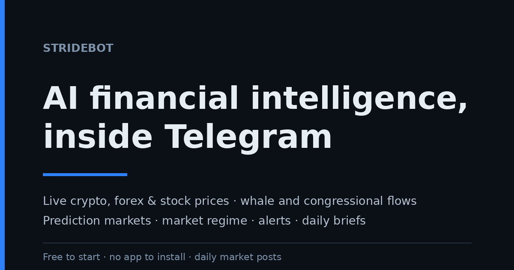

# StrideBot — AI Crypto, Forex & Stock Intelligence Bot for Telegram

**StrideBot** is an AI financial intelligence bot for Telegram. Ask a market question in plain English or send a simple command and get live crypto, forex and stock prices, AI analysis, news, whale flows, congressional trades and prediction-market odds — without installing an app or creating an account.

[**Open StrideBot on Telegram**](https://t.me/AskStrideBot) · [Website](https://stridebot-production.onrender.com/) · [Updates channel](https://t.me/StreetLevelTech)



StrideBot covers crypto, forex, stocks, macro and prediction markets in one chat. It is free to start, works in private chats and groups, and answers with live data instead of canned text.

---

## What you can do with StrideBot

- **Live prices** — crypto, stocks and forex, including NGN exchange rates.
- **AI analysis** — coin and forex analysis built from live data, plus deep stock analysis and topic research on Premium.
- **Market overview** — top movers, a full market update, and the current market regime (risk-on / risk-off).
- **News that matters** — headlines, AI summaries, and topic monitors that only report worthwhile updates.
- **Watchlists and price alerts** — track the assets you care about and get a message when a target is hit.
- **Intelligence** — large whale transfers, congressional trades, prediction-market odds and crypto narrative sectors.
- **Portfolio tracking** — holdings, realised and unrealised P&L, and weekly reports on Premium.
- **Your own setup** — timezone, daily briefs, memory controls and notification settings.

---

## Get started

1. Open [@AskStrideBot](https://t.me/AskStrideBot) and tap **Start** (or send `/start`).
2. Set your timezone when prompted — briefs and alerts then arrive at the right time for you.
3. Try a command, or just ask a question:

   ```text
   /price btc
   /analyze eth
   /stockprice aapl
   What's driving the market today?
   ```

4. Add **@AskStrideBot** to a group and mention it there for instant prices and analysis without leaving the conversation.

Prefer a visual view? Open the **Mini App** from `/start` or `/help` for live market cards, movers, the leaderboard and — on Premium — your portfolio.

---

## Popular commands

### Markets

| Command | What it does |
|---|---|
| `/price <coin>` | Live price of any cryptocurrency |
| `/top10` | Top 10 cryptocurrencies by market cap |
| `/marketupdate` | Full market overview with movers |
| `/stockprice <ticker>` | Live stock quote |
| `/forex` | Live forex rates |
| `/rates` | NGN exchange rates |
| `/regime` | Current market regime (risk-on / risk-off) |
| `/polymarket` | Live prediction-market odds |

### Analysis and news

| Command | What it does |
|---|---|
| `/analyze <coin>` | AI analysis of a coin using live data |
| `/forexanalysis` | Forex pair analysis and outlook |
| `/summary` | AI-curated news summary |
| `/news` | Latest financial headlines |
| `/track <topic>` | Monitor a topic and report what matters (`/track list`, `/track cancel <number>`) |
| `/simulate <coin> <amount> <date>` | See what an investment would be worth today |
| `/stock <ticker>` | Live quote plus deep AI stock analysis — **Premium** |
| `/research <topic>` | Deep research on an open market question — **Premium** |

### Watchlists, alerts and intelligence

| Command | What it does |
|---|---|
| `/watch <coin>` | Add an asset to your watchlist (`/watch list`, `/watch remove <coin>`) |
| `/alert btc above 100000` | Get notified when a price target is reached |
| `/myalerts` | View your active alerts |
| `/whale` | Large on-chain movements ($1M+) |
| `/congress` | Congressional stock trades and crypto bills |
| `/narratives` | Browse and follow crypto narrative sectors |

### Account and plans

| Command | What it does |
|---|---|
| `/settings` | Configure briefs, notifications and display options |
| `/timezone` | Set your local timezone |
| `/portfolio` | Track crypto and stock holdings with P&L — **Premium** |
| `/premium` | See plans and upgrade |
| `/refer` | Invite friends and earn rewards |
| `/myplan` | Check your subscription — **Premium** |
| `/mymemory` | See and manage what StrideBot remembers |
| `/privacy` | Control memory and personalisation |
| `/help` | Full command menu |

---

## Explore every command

Each command has its own page with a real example and what it returns:

- [Live crypto price](https://stridebot-production.onrender.com/commands/price)
- [Top 10 cryptocurrencies](https://stridebot-production.onrender.com/commands/top10)
- [Market update](https://stridebot-production.onrender.com/commands/marketupdate)
- [Stock quote](https://stridebot-production.onrender.com/commands/stockprice)
- [Forex rates](https://stridebot-production.onrender.com/commands/forex)
- [AI coin analysis](https://stridebot-production.onrender.com/commands/analyze)
- [Market regime](https://stridebot-production.onrender.com/commands/regime)
- [Whale activity](https://stridebot-production.onrender.com/commands/whale)
- [Congressional trades](https://stridebot-production.onrender.com/commands/congress)
- [Prediction markets](https://stridebot-production.onrender.com/commands/polymarket)
- [Price alerts](https://stridebot-production.onrender.com/commands/alert)
- [Watchlist](https://stridebot-production.onrender.com/commands/watch)

---

## Guides

Longer reads for the questions a command cannot answer:

- [How to track crypto whale activity](https://stridebot-production.onrender.com/guides/crypto-whale-tracking) — what a whale transfer is and how to read one without overreacting.
- [How to set crypto price alerts on Telegram](https://stridebot-production.onrender.com/guides/crypto-price-alerts-telegram) — absolute and percentage alerts, and how to manage them.
- [How to track congressional stock trades](https://stridebot-production.onrender.com/guides/congressional-stock-trades) — disclosures, tickers and the delay that matters.
- [What AI crypto analysis can and cannot tell you](https://stridebot-production.onrender.com/guides/ai-crypto-analysis) — what `/analyze` does and the questions it will not answer.

---

## Free and Premium

**Free** includes live prices, AI coin analysis, news, watchlists and alerts, whale and congressional intelligence, prediction markets, narratives, daily briefs and referrals.

**Premium** adds:

- Unlimited AI responses and real-time web search
- Deep market analysis and full stock analysis
- Extended conversation memory and permanent preference memory
- Portfolio tracking with weekly reports
- Deep research, custom brief settings and the Secretary Bot

Plans are paid in Telegram Stars, weekly or monthly. Send `/premium` in the bot for current pricing.

---

## Privacy and your data

StrideBot keeps only what it needs to run the bot — your timezone, watchlists, alerts, portfolio and any memory you allow. Nothing else is required to use it.

- `/mymemory` — review what it remembers
- `/forget` — erase everything it remembers about you
- `/privacy` — manage memory and personalisation
- `/clear` — clear your conversation history

---

## Frequently asked

**Is StrideBot free?**
Yes. All the free commands above cost nothing. Premium adds the extras listed under [Free and Premium](#free-and-premium).

**Do I need to install an app?**
No. StrideBot runs inside Telegram. Send a command or ask a market question in plain language.

**Does StrideBot give investment advice?**
No. It provides live market data and analysis — the decision is always yours.

**How fresh is the data?**
Crypto prices refresh on a short cycle, stock quotes are market-hours aware, and analysis is generated from live data when you ask. When a feed is down, StrideBot says so instead of guessing.

**Can I use StrideBot in a group?**
Yes. Add **@AskStrideBot** to a group and mention it to get prices and analysis in the conversation.

---

## Disclaimer

StrideBot provides market data and analysis, not financial advice. Markets carry risk, and every decision is your own.

---

## Support

- **Open the bot:** [@AskStrideBot](https://t.me/AskStrideBot)
- **Updates:** [StreetLevelTech channel](https://t.me/StreetLevelTech)
- **Support:** [@Chapo_Ray](https://t.me/Chapo_Ray)
- **Website:** [stridebot-production.onrender.com](https://stridebot-production.onrender.com/)

---

## License

StrideBot is proprietary software. All rights reserved. See [LICENSE](LICENSE) for the terms; no part of the software may be copied, modified or redistributed without written permission.

---

## About this repository

This is the public product page for StrideBot — product information, the command reference and the issue tracker. The bot's source code is proprietary and is not published here.
